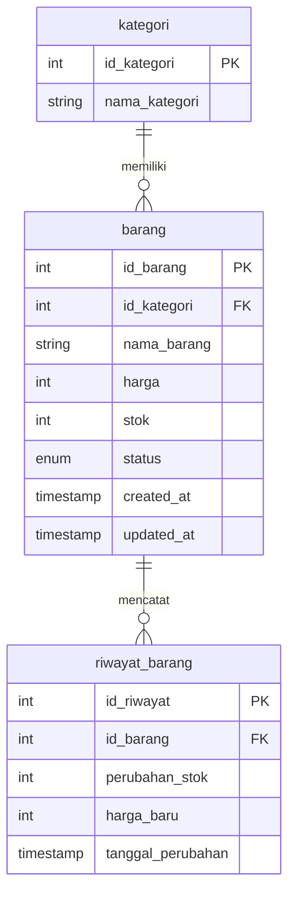

# UTS P Web - Manajemen Stok Barang

Mini web app untuk mencatat stok barang. Dibuat untuk Tugas UTS Matkul P Web (HTML, CSS, JavaScript, jQuery, Bootstrap, dan PHP).

## Identitas

* Nama: Benny Javerson D A
* NIM: 252410103106
* Tema: No. 6 - Manajemen Stok Barang Sederhana
* Repository: [bennyjaverson/UTS-P-Web](https://github.com/bennyjaverson/UTS-P-Web)

## Fitur

* Form tambah stok barang (nama barang, kategori, harga, dan stok).
* Pilihan kategori diambil langsung dari database (tabel `kategori`).
* Kalau barang dengan nama dan kategori yang sama sudah ada, stoknya otomatis bertambah. Kalau belum ada, disimpan sebagai barang baru.
* Fitur urutkan (sorting) daftar barang berdasarkan ID, Kategori, Harga (termurah/termahal), dan Stok (terkecil/terbanyak).
* Tabel daftar barang tampil luas (100% lebar layar) lengkap dengan ID, nama, kategori, harga, stok, status, tanggal ditambah, dan tanggal terakhir diupdate.
* Label **Stok Menipis** muncul otomatis kalau stok tersisa 5 atau kurang.
* Label status barang (**Dijual** / **Tidak Dijual**).
* Validasi input di sisi depan (jQuery) dan di server (PHP).
* Alert notifikasi (sukses/error) yang hilang sendiri secara otomatis.

## Teknologi

* HTML5, CSS3, JavaScript, jQuery 3.7.1
* Bootstrap 5.0.2
* PHP (mysqli) dan MySQL
* Laragon / XAMPP untuk server lokal

## Struktur File

```
.
├── index.php                halaman utama (form input, validasi, fitur urutkan, dan tabel)
├── koneksi.php              koneksi ke database db_inventaris_toko
├── style.css                tampilan dan penataan layout
├── script.js                validasi form dan efek alert (jQuery)
├── db_inventaris_toko.sql   file export database db_inventaris_toko
└── README.md                dokumentasi proyek
```

## Struktur Database

Database: `db_inventaris_toko`



```text
[ kategori ] (1) ─────────── (N) [ barang ] (1) ─────────── (N) [ riwayat_barang ]
   ├─ id_kategori (PK)             ├─ id_barang (PK)                 ├─ id_riwayat (PK)
   └─ nama_kategori                ├─ id_kategori (FK)               ├─ id_barang (FK)
                                   ├─ nama_barang                    ├─ perubahan_stok
                                   ├─ harga                          ├─ harga_baru
                                   ├─ stok                           └─ tanggal_perubahan
                                   ├─ status
                                   ├─ created_at
                                   └─ updated_at
```

### Penjelasan Relasi Tabel:
1. **`kategori` ke `barang` (1 : N)**: Satu kategori bisa digunakan oleh banyak barang.
2. **`barang` ke `riwayat_barang` (1 : N)**: Satu barang bisa memiliki banyak catatan riwayat stok/harga.

## Cara Menjalankan

1. Nyalakan **Laragon** atau **XAMPP** (Apache dan MySQL).
2. Buka phpMyAdmin, lalu import file `db_inventaris_toko.sql` agar database dan data awalnya langsung terbuat.
3. Simpan folder proyek ini di dalam folder `laragon/www/` atau `xampp/htdocs/`.
4. Buka browser lalu ketik `http://localhost/nama-folder-proyek/`.

Pengaturan koneksi ada di `koneksi.php` (host `localhost`, user `root`, password kosong, database `db_inventaris_toko`).

## Cara Kerja / Logika Utama

1. Saat form diisi dan dikirim, jQuery mengecek isian terlebih dahulu. Jika ada yang kosong atau salah, form tidak terkirim dan muncul pesan error merah.
2. PHP di server juga mengecek ulang. Jika ada yang salah, pesan disimpan di variabel `$errors`.
3. Jika data sudah benar, PHP mengecek apakah barang sudah ada di database. Jika sudah ada, stoknya di-update (ditambah). Jika belum, disimpan sebagai data baru.
4. Untuk fitur urutkan (sorting), PHP mengambil pilihan dari dropdown (`$_GET['sort']`) lalu menyesuaikan urutan data saat mengambil dari database.
5. Data barang diambil dari tabel `barang` yang digabung (`JOIN`) dengan tabel `kategori`.
6. Jika berhasil, halaman diarahkan kembali ke `index.php?status=sukses` dan muncul alert hijau yang hilang sendiri.

## Aturan Validasi Input

| Field | Aturan |
| ----- | ----- |
| Nama barang | Wajib diisi |
| Kategori | Wajib memilih salah satu kategori |
| Harga | Harus berupa angka lebih dari 0 |
| Stok | Harus berupa angka lebih dari 0 |
